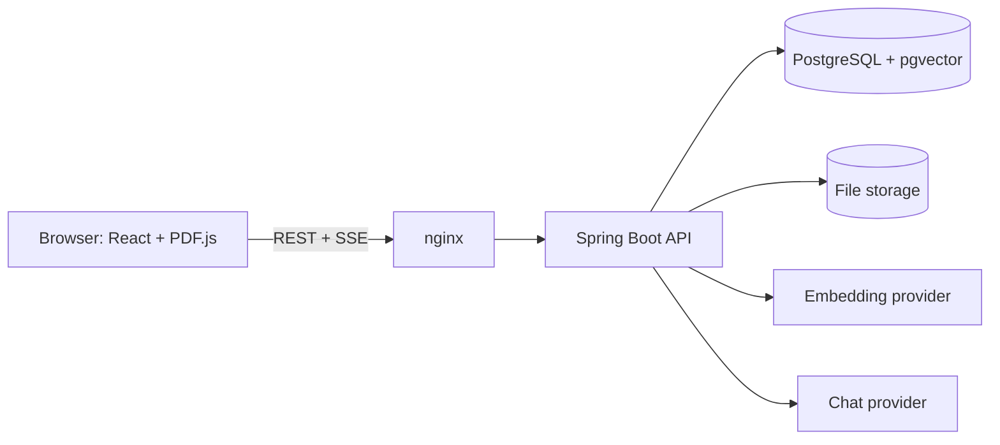
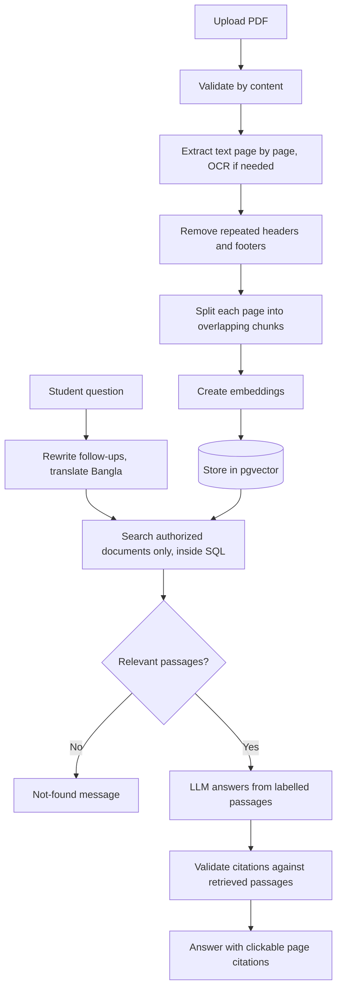
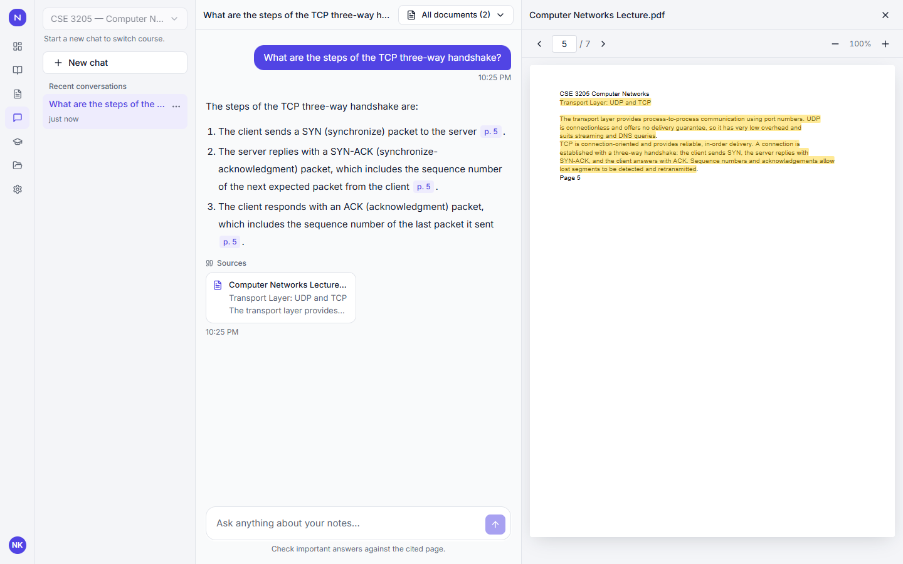
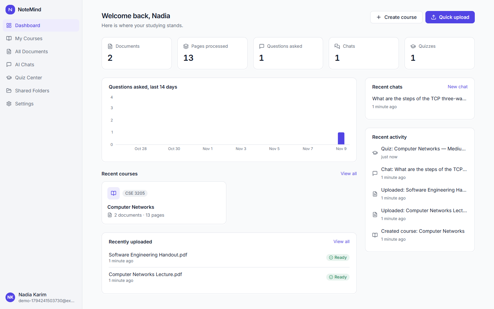
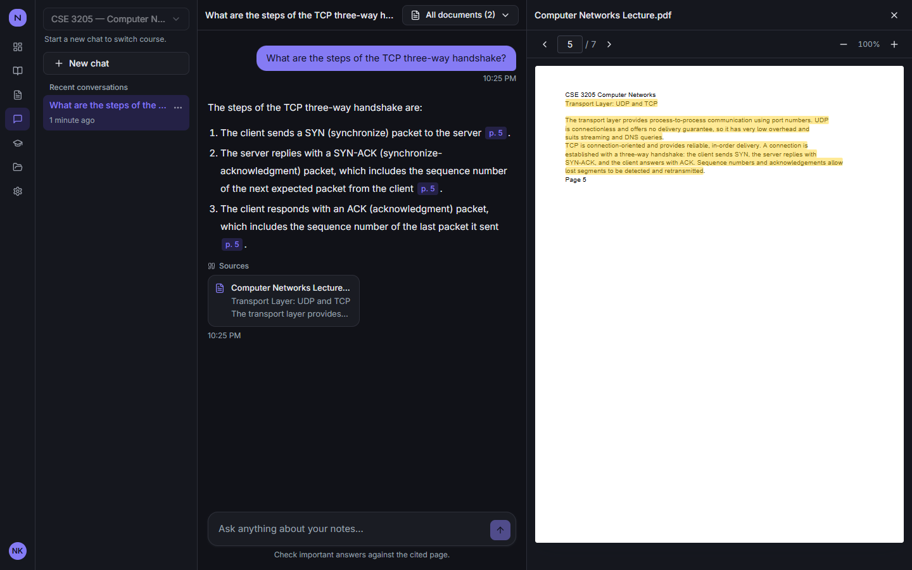
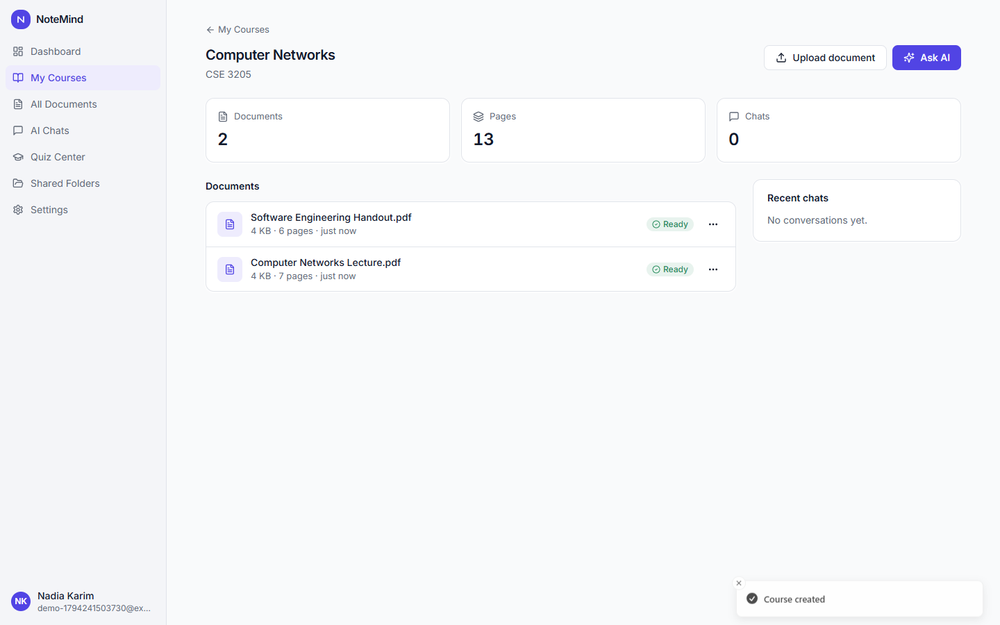
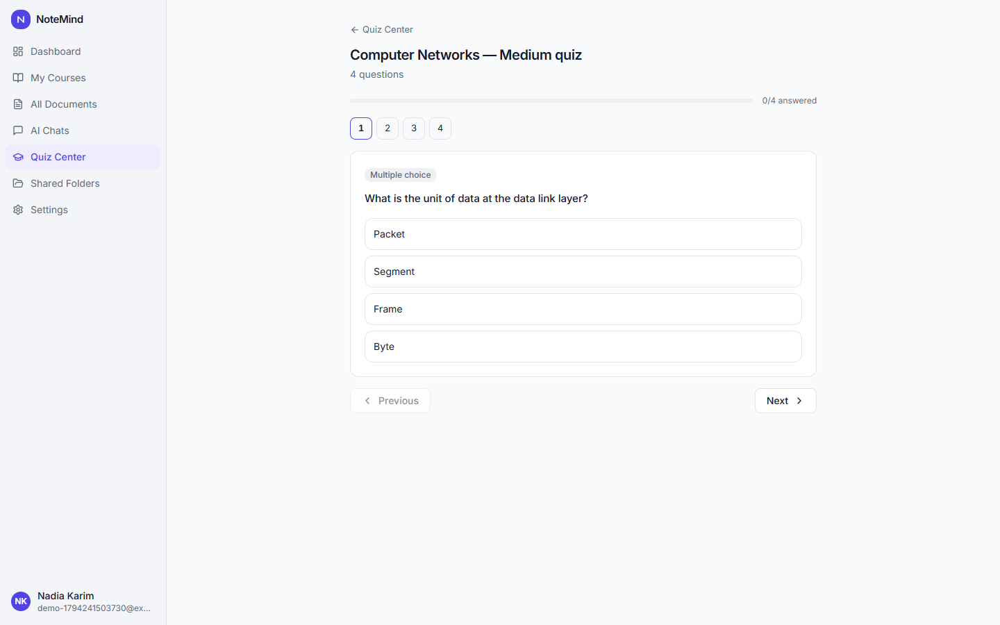
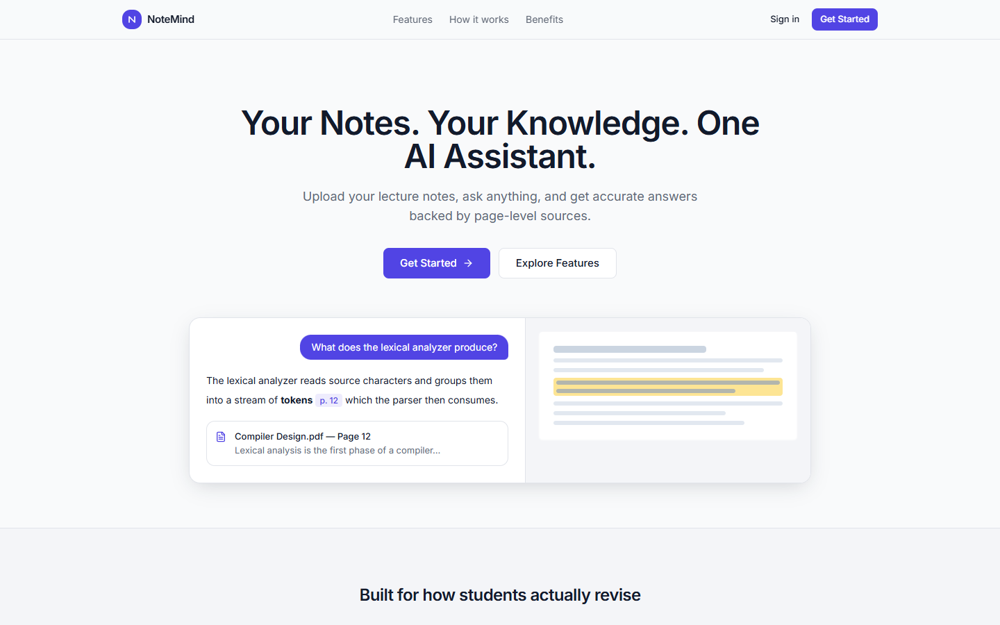
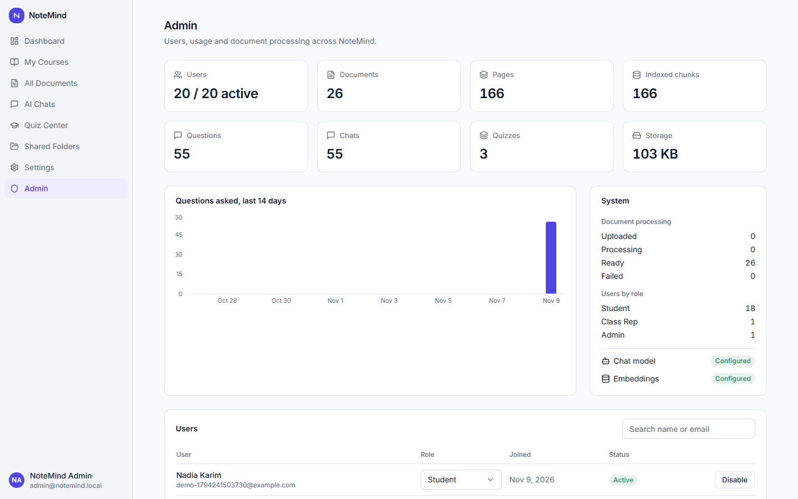

# NoteMind

**Your Lecture Notes. Your AI Study Partner.**

NoteMind is a full-stack RAG application. Students upload lecture PDFs, ask questions in natural language, and get answers grounded in those notes, with citations that open the exact PDF page and highlight the source passage.

## Problem

Students have hundreds of pages of slides and PDFs to get through before exams, and finding one specific fact by hand is slow. General chatbots do not know the course material and can invent answers. NoteMind answers only from what was uploaded, says so when the notes do not cover something, and shows where each claim came from.

## Features

- **Hybrid retrieval**: pgvector similarity plus PostgreSQL full-text search, merged by rank fusion. Only relevant passages go to the model, never the whole PDF.
- **Page-level citations**: click a citation and the PDF opens at that page with the passage highlighted.
- **Honest failure**: a relevance gate returns a clear "not found" message without calling the model.
- **Streaming chat** over Server-Sent Events, with a stop button and history.
- **Search scope**: one document, several, or a whole course.
- **Quiz generator**: MCQ, true/false and short answer, each linked to a source page.
- **Shared class folders** with per-member access.
- **Bangla and English** questions.
- **OCR** for scanned pages with Tesseract.
- **Dashboards** for students and admins, dark mode, responsive layout.
- **Swappable AI providers** through environment variables.

## Technology

| Layer | Stack |
|---|---|
| Backend | Java 21, Spring Boot 3.5, Spring AI 1.1, Spring Security, Spring Data JPA, Flyway, PDFBox |
| Frontend | React 19, TypeScript, Vite, Tailwind CSS, shadcn-style components on Radix, TanStack Query, React Hook Form, Zod, react-pdf, Recharts |
| Data | PostgreSQL 17, pgvector |
| Infrastructure | Docker Compose, nginx, GitHub Actions |

## Architecture



More detail is in [docs/architecture.md](docs/architecture.md).

## How a PDF becomes an answer



1. **Extraction.** PDFBox reads each page separately, so original page numbers are preserved.
2. **Chunking.** Text is split at paragraph, then sentence, then line boundaries, with overlap. A chunk never crosses a page, so each citation points to exactly one page.
3. **Embedding.** Chunks become vectors, by default with a local model that needs no API key.
4. **Retrieval.** Search is restricted to the user's documents in the SQL itself, then ranked by combined vector and keyword rank, and filtered by a similarity threshold.
5. **Generation.** The model sees only the retrieved passages, labelled `[S1]`, `[S2]`…, and cites those labels. Document names and page numbers shown to the student come from the database, so a made-up page cannot be displayed as a citation.

## Database

Schema: users, refresh_tokens, courses, documents, chunks, chats, messages, quizzes, quiz_attempts, class_folders, folder_members. See [docs/database-design.md](docs/database-design.md).

## Screenshots

**Chat with a page citation.** Clicking "p. 5" opens that page with the cited passage highlighted.



| Dashboard | Dark mode |
|---|---|
|  |  |

| Course | Quiz |
|---|---|
|  |  |

| Landing page | Admin |
|---|---|
|  |  |

## Measured results

From one run of each evaluation, using the local `llama3.2` model and a small test set written by the project author. Real lecture slides and other models will differ.

| Check | Result |
|---|---|
| Correct page ranked first by retrieval | 25/25 |
| Answer contains the expected key term | 25/25 |
| Answer cites the expected document and page | 25/25 |
| Off-topic questions answered "not found" | 8/8 |
| Near-topic questions (fact absent from notes) answered "not found" | 4/4 |
| Follow-up questions retrieve the expected page | 2/2 |
| Instructions hidden in PDFs ignored | 3/3 |
| Bangla questions: expected page retrieved | 3/4 |

Known weakness: `llama3.2` writes Bangla poorly and got at least one Bangla answer wrong, even with the correct page retrieved. Details are in [evaluation/generation_results.md](evaluation/generation_results.md) and [evaluation/results.md](evaluation/results.md).

## Requirements

- Docker with Compose

For running without Docker: JDK 21, Node 22, and a PostgreSQL instance with pgvector.

## Environment

```bash
cp .env.example .env
```

Set `DB_PASSWORD` and `JWT_SECRET` (`openssl rand -base64 48`). Set `NOTEMIND_ADMIN_EMAIL` and `NOTEMIND_ADMIN_PASSWORD` to create the first admin. Registration only ever creates students; an admin can promote a user to class representative.

### Connecting an AI model

Without a chat model, NoteMind still retrieves and cites passages but shows them directly instead of writing an answer, and cannot generate quizzes. Pick one in `.env`:

| Provider | Settings |
|---|---|
| OpenAI | `NOTEMIND_CHAT_PROVIDER=openai`, `OPENAI_API_KEY=...` |
| Groq | as OpenAI, plus `OPENAI_BASE_URL=https://api.groq.com/openai`, `NOTEMIND_CHAT_MODEL=...` |
| Gemini | as OpenAI, plus `OPENAI_BASE_URL=https://generativelanguage.googleapis.com/v1beta/openai`, `OPENAI_COMPLETIONS_PATH=/chat/completions`, `NOTEMIND_CHAT_MODEL=...` |
| Anthropic | `NOTEMIND_CHAT_PROVIDER=anthropic`, `ANTHROPIC_API_KEY=...` |
| Ollama (free, local) | `NOTEMIND_CHAT_PROVIDER=ollama`, `NOTEMIND_CHAT_MODEL=llama3.2`, then the commands below |

For Ollama, also add `COMPOSE_PROFILES=ollama` to `.env` so its container starts with the stack, then download the model once:

```bash
docker compose up -d
```

```bash
docker compose exec ollama ollama pull llama3.2
```

Ollama runs on the CPU here, so expect roughly half a minute per answer. A hosted provider is much faster and generally more accurate.

Embeddings default to the local `transformers` provider at 384 dimensions. To use another embedding model, set the provider, model and matching `NOTEMIND_EMBEDDING_DIMENSION` before the first start, then re-run the evaluation to choose a threshold.

## Run with Docker

```bash
docker compose up -d --build
```

Open <http://localhost:8088>. The first start downloads the local embedding model and its native engine (a few hundred MB, kept in a volume), so the backend can take several minutes to become healthy. Sample PDFs are in `evaluation/corpus/`.

## Run the backend separately

```bash
docker compose up -d db
```

```bash
cd backend
DB_PASSWORD=<your password> JWT_SECRET=<your secret> ./mvnw spring-boot:run
```

The API listens on port 8080.

## Run the frontend separately

```bash
cd frontend
npm install
npm run dev
```

Open <http://localhost:5173>. Vite proxies `/api` to port 8080.

## API

See [docs/api-documentation.md](docs/api-documentation.md).

## Testing

```bash
cd backend && ./mvnw verify
```

```bash
cd frontend && npm test
```

Backend integration tests use Testcontainers, so Docker must be running. AI providers are replaced with test doubles, so no API key is needed. The cross-user isolation proofs are in `CrossUserSecurityIT`.

Retrieval quality is measured separately. See [evaluation/methodology.md](evaluation/methodology.md) and [evaluation/results.md](evaluation/results.md), including their stated limitations.

## Security

- BCrypt password hashing, short-lived JWTs held in memory, rotating refresh tokens in `HttpOnly` cookies
- Role-based authorization, with role and account status checked against the database on every request
- Resource ownership checks; another user's resource returns 404
- Authorization enforced **inside the vector search SQL**, never left to the model
- PDFs validated by content, opaque storage keys, path traversal protection
- Per-user rate limits on AI requests and uploads, per-IP limits on sign-in
- Retrieved text treated as untrusted and separated from system instructions
- Secrets only from the environment; the app refuses to start with a weak JWT secret

## Future improvements

- Redis-backed rate limiting and a job queue for multiple backend instances
- S3-compatible implementation of `FileStorage`
- A cross-encoder re-ranking step
- A multilingual embedding model for direct Bangla retrieval
- Word-level highlighting on OCR pages
- Evaluation on real course material
