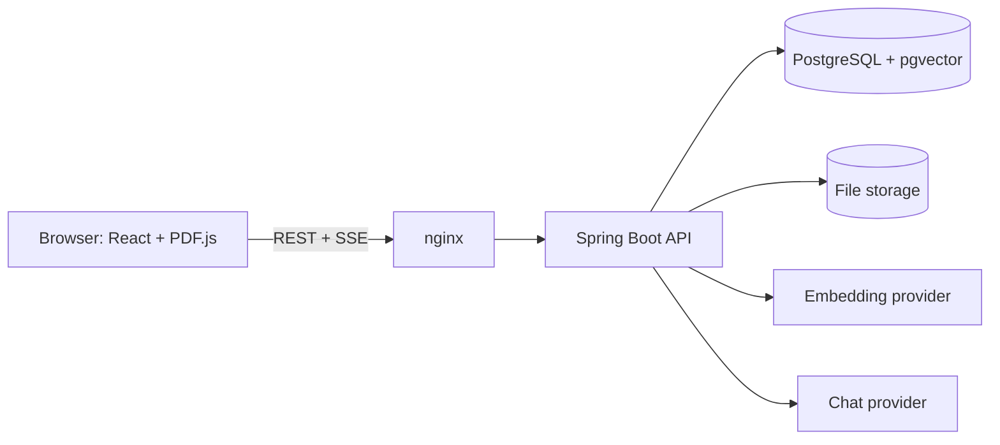
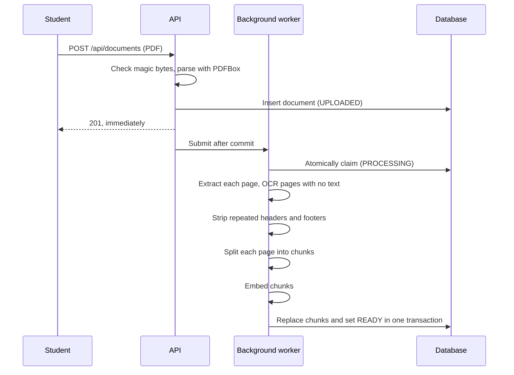
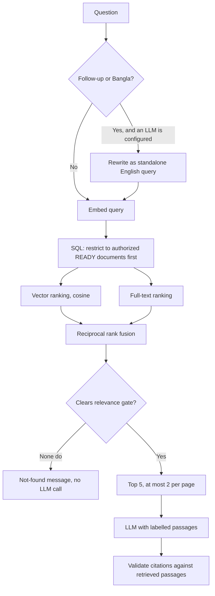

# Architecture

## System overview

nginx serves the built frontend and proxies `/api`. Browser and API therefore share one origin, which lets the refresh cookie be `SameSite=Strict`.

## Backend packages

| Package | Responsibility |
|---|---|
| `controller` | HTTP mapping only |
| `service` | Business rules, including `AccessControlService`, the single answer to "may this user touch this?" |
| `repository` | Spring Data interfaces, plus `ChunkRepository` for pgvector SQL |
| `document` | Upload validation, storage, extraction, OCR, cleaning, chunking, background processing |
| `ai` | Provider interfaces, retrieval, prompts, citation validation, streaming, quiz generation |
| `security` | JWT, filter chain, rate limiting |

## Document pipeline

- **Exact page numbers.** A chunk never crosses a page, so each citation has exactly one page. The cost is that a paragraph split across two pages becomes two chunks.
- **No duplicate work.** `claimForProcessing` is a conditional `UPDATE`, so only one worker can win.
- **Safe retries.** Old chunks are replaced in the same transaction that sets `READY`.
- **Restart recovery.** Interrupted documents are re-queued at startup. This assumes a single backend instance.

## Retrieval

**Why custom SQL instead of Spring AI's `PgVectorStore`:** the requirement is that authorization happens inside the query. `chunks` joins relationally to `documents`, `class_folders` and `folder_members`, which metadata filters on a generic table cannot express. Spring AI still provides the embedding and chat models.

**Why hybrid:** embeddings capture meaning but can miss exact terms like acronyms. Keyword rank has half the weight of vector rank. `evaluation/results.md` shows the effect.

**Broad requests** like "summarize chapter 2" have no single passage that resembles them, so they use a relaxed threshold and a larger limit.

**Index note.** A per-user search usually runs as an exact scan of that user's chunks, which has perfect recall and stays fast at this scale. The HNSW index and `hnsw.iterative_scan` apply if the planner chooses the index for larger tenants.

## Citations

The model never writes page numbers. Passages are labelled `[S1]`, `[S2]`…, and the model cites labels. `CitationValidator` removes any label that does not match a retrieved passage. The document name and page shown to the student come from the database row, so a hallucinated page number cannot appear in a citation.

Small models often ignore the label format, so citations do not depend on the model complying. When an answer contains no valid labels, `CitationValidator` compares each sentence with the retrieved passages and labels it only if at least 60% of its content words appear in one passage. Sentences that match nothing stay unlabelled. If nothing matches at all, the passages are shown under a heading saying the answer did not cite them directly.

In the browser, PDF.js renders the cited page. `pdfHighlight.ts` finds the passage in the page's text items by comparing letters and digits only, because PDFBox and PDF.js differ in spacing, hyphenation and ligatures.

## AI provider abstraction

The application depends only on `LlmClient` and `EmbeddingClient`. Providers are chosen by configuration through Spring AI:

| Setting | Values |
|---|---|
| `NOTEMIND_CHAT_PROVIDER` | `openai` (or any OpenAI-compatible host), `anthropic`, `ollama`, `none` |
| `NOTEMIND_EMBEDDING_PROVIDER` | `transformers` (local), `openai`, `ollama` |

With `none`, retrieval and citations still work, and the app shows the real passages under a clear notice instead of a written answer.

## Security model

- Passwords use BCrypt. Access tokens are 15-minute JWTs held in memory.
- Refresh tokens are random, rotated on use, stored only as SHA-256, and sent in an `HttpOnly`, `SameSite=Strict` cookie. Replaying a rotated token after a 10-second grace window revokes all of that user's sessions.
- Role and enabled status are read from the database on each request, so disabling an account applies immediately.
- A resource belonging to someone else returns 404, so identifiers cannot be used to probe for existence.
- PDF text is untrusted. It sits in a user message inside a per-request random boundary, separate from system instructions.
- Text from PDFs is HTML-escaped before it reaches the highlight layer.

## Known limitations

- Rate limits and restart recovery assume one backend instance.
- OCR pages have no PDF text layer, so they open at the correct page without a highlight.
- The default local embedding model is English-focused. Bangla questions are translated for search only when an LLM is configured.
