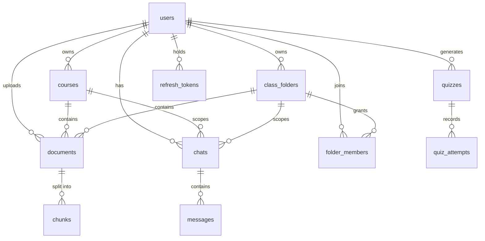

# Database design

PostgreSQL 17 with pgvector. Schema changes are managed by Flyway in `backend/src/main/resources/db/migration`.

## Differences from the original outline

| Addition | Reason |
|---|---|
| `refresh_tokens` table | Revocable, rotating sessions |
| `documents.folder_id`, `chats.folder_id` | Shared folders hold documents and chats. A `num_nonnulls` constraint requires exactly one of course or folder |
| `chunks.content_tsv` | Generated column for full-text search |
| `quizzes.difficulty`, `quiz_attempts.total` | Needed to display results |
| `courses.updated_at` | Consistent auditing |

## Cascades

| Delete | Effect |
|---|---|
| Document | Its chunks are removed. Quizzes keep their content, with `document_id` set to NULL |
| Course | Its documents, chunks and chats are removed. Quizzes keep their content |
| Folder | Its documents, chunks, chats and memberships are removed |
| Chat | Its messages are removed |

Stored PDFs are deleted only after the transaction commits, so a rollback cannot leave a row pointing at a missing file.

## Indexes

| Index | Purpose |
|---|---|
| `idx_chunks_document_page` | Restricting search to authorized documents |
| `idx_chunks_tsv` (GIN) | Full-text search |
| `idx_chunks_embedding_hnsw` | Approximate vector search with cosine distance |
| `idx_chats_user_updated`, `idx_documents_user`, `idx_courses_user`, `idx_quizzes_user` | Per-user lists |
| `idx_messages_chat_created` | Loading a conversation in order |

## Embedding dimension

`chunks.embedding` is `VECTOR(${embedding_dimension})`, filled in by Flyway from `NOTEMIND_EMBEDDING_DIMENSION`. The application refuses to start if the setting and the column disagree. To change model dimension on an existing database, add a migration that alters the column and re-embed the documents. HNSW supports up to 2000 dimensions.
